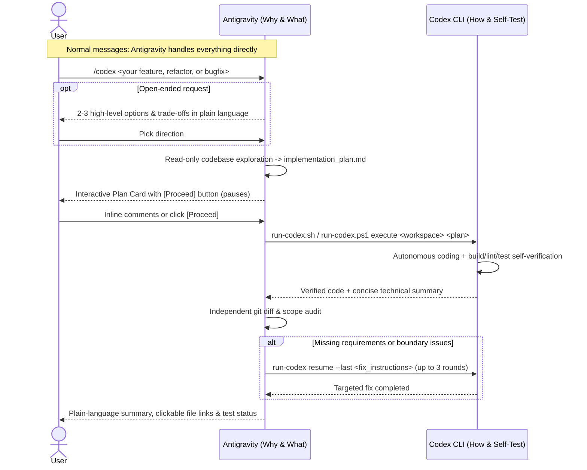

<p align="center">
  
</p>

<h1 align="center">antigravity-codex</h1>

<p align="center">
  <strong>Google Antigravity × OpenAI Codex — On-Demand Dual-Agent Workflow (<code>/codex</code>)</strong>
</p>

<p align="center">
  English | <a href="./README.zh-CN.md">简体中文</a>
</p>

<p align="center">
  
</p>

---

## Why `antigravity-codex`?

A lightweight, zero-dependency native plugin for **Google Antigravity** that pairs **Antigravity** and **Codex CLI** using their complementary strengths — **only when you type `/codex`**:

- **Zero Intrusion by Default**: Ships with `skills/codex` only (no global `rules/AGENTS.md`). Everyday chats and small edits stay 100% native Antigravity with zero context bloat.
- **Native Antigravity Approval UI**: Uses Antigravity's native `implementation_plan.md` artifact (`RequestFeedback: true`) to render an interactive **Proceed** button and inline commenting before a single line of code is touched.
- **Clear Separation of Responsibilities (`Why & What` vs. `How`)**:
  - **Antigravity (Architecture & Final Review)** owns divergent brainstorming, human-readable specs, edge-case guardrails, scope boundaries, and final diff review.
  - **Codex CLI (Engineering & Self-Test)** owns idiomatic implementation and runs build/lint/unit-test loops on the spot before handing back working code.
- **Zero External Bridges & 100% Official Channels**: No MCP servers, no reverse proxies, no tmux wrappers — just a native Antigravity plugin invoking the official `codex exec` / `codex exec resume --last` CLI.
- **Quota-Friendly Quiet Log-Summary Mode**: Offloads multi-file coding and compile/test fix loops into a single shell turn. By default, verbose Codex process logs are written to a `.log` file while only the concise final summary is returned to Antigravity (set `CODEX_VERBOSE=1` for full streaming), paired with concise output discipline and visual-first UI alignment.
- **Cross-Platform**: Works out of the box on **macOS, Linux, and Windows (PowerShell)**.

---

## How It Works



---

## Prerequisites

1. **Google Antigravity** installed.
2. **OpenAI Codex CLI** installed and signed in (either standalone via `npm install -g @openai/codex` / `brew install codex`, or bundled with ChatGPT Desktop on macOS):
   ```bash
   codex --version
   codex login status
   ```
   If not signed in yet, run `codex login` once in your terminal.

---

## Installation (Choose Either Way)

### Option A: One-Command CLI Installer (Recommended)

**macOS / Linux:**
```bash
git clone https://github.com/19zbhy/antigravity-codex.git
cd antigravity-codex
./install.sh
```

**Windows (PowerShell):**
```powershell
git clone https://github.com/19zbhy/antigravity-codex.git
cd antigravity-codex
.\install.ps1
```

The installer automatically:
- Copies the plugin bundle to `~/.gemini/config/plugins/codex-collaborator`
- Replaces `<USER_HOME>` with your literal absolute home path (required for Antigravity's `Always Allow` command prefix matching)
- Configures `run-codex.sh` (macOS/Linux) or `run-codex.ps1` (Windows) and validates syntax & `codex` CLI availability

### Option B: Agent-Native Zero-CLI Install (Drop Into Antigravity)

Don't want to touch the terminal? Drag and drop [docs/INSTALL_WITH_ANTIGRAVITY.md](./docs/INSTALL_WITH_ANTIGRAVITY.md) directly into an Antigravity chat and say:

> *"Please follow this guide to install and verify the `/codex` plugin on my machine."*

Antigravity will detect your home directory, install the plugin files, and verify live registration automatically.

---

## Usage

1. **Regular tasks**: Just chat normally — Gemini responds and edits code directly.
2. **Complex features / refactors / tricky bugs**: Type **`/codex <your request>`** in the Antigravity input box.
3. **Approve the plan**: Review the generated `implementation_plan.md` card, leave inline comments if needed, and click **Proceed**.
4. **First-time permission**: When Antigravity prompts to run `run-codex.sh` (or `run-codex.ps1`), click **Always Allow** so future runs are completely seamless.

---

## Repository Structure

```text
antigravity-codex/
├── README.md                              # English documentation
├── README.zh-CN.md                        # Chinese documentation
├── LICENSE                                # MIT License
├── install.sh                             # macOS / Linux installer
├── install.ps1                            # Windows PowerShell installer
├── assets/
│   ├── logo.svg
│   └── workflow-preview.png               # Workflow visual showcase
├── docs/
│   └── INSTALL_WITH_ANTIGRAVITY.md        # Agent-native drag-and-drop SOP
└── plugin/                                # Plugin template (no hardcoded paths)
    ├── plugin.json
    ├── README.md
    ├── assets/logo.svg
    └── skills/codex/
        ├── SKILL.md                       # /codex workflow skill definition
        └── scripts/
            ├── run-codex.sh               # macOS / Linux runner (Bash 3.2 safe)
            └── run-codex.ps1              # Windows PowerShell runner
```

---

## Acknowledgements

- Quiet log-summary output, concise output discipline, and visual/UI ownership separation were inspired by [xinqinnain/antigravity-codex-commander](https://github.com/xinqinnain/antigravity-codex-commander).

---

## License

[MIT](./LICENSE)
