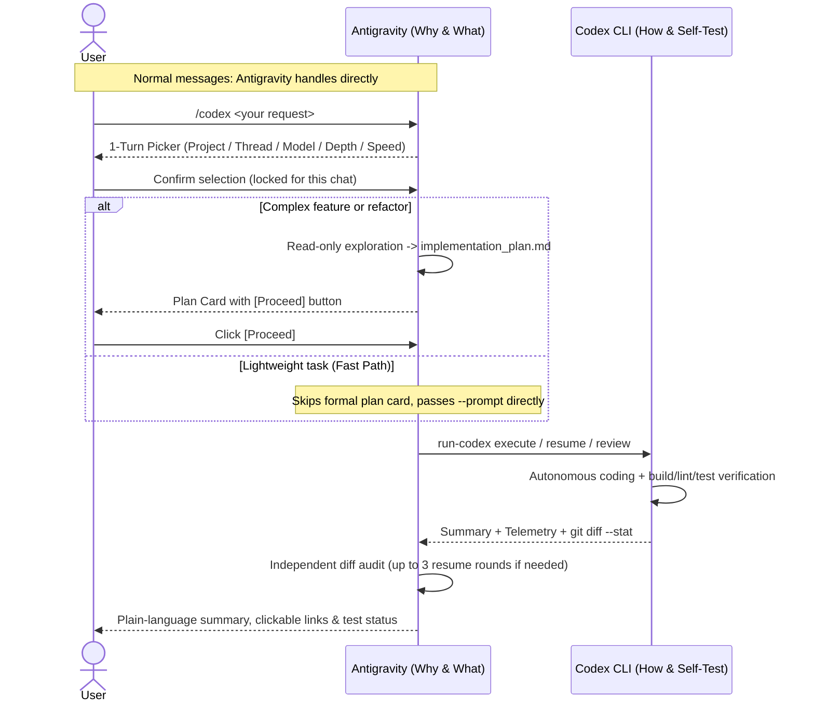

<p align="center">
  
</p>

<h1 align="center">antigravity-codex</h1>

<p align="center">
  <em><code>/codex</code> is all you need.</em>
</p>

<p align="center">
  <strong>Google Antigravity × OpenAI Codex — On-Demand Dual-Agent Workflow</strong>
</p>

<p align="center">
  English | <a href="./docs/README.zh-CN.md">简体中文</a> | <a href="https://19zbhy.github.io/antigravity-codex/">Project Homepage</a>
</p>

<p align="center">
  <a href="https://github.com/19zbhy/antigravity-codex/actions/workflows/ci.yml">
    
  </a>
  <a href="./LICENSE">
    
  </a>
  
</p>

<p align="center">
  
</p>

> [!NOTE]
> Independent community project. Not affiliated with or endorsed by Google, Antigravity, or OpenAI. See [SECURITY.md](./docs/SECURITY.md) and [CHANGELOG.md](./docs/CHANGELOG.md).

---

## 1. Why Use Codex Inside Antigravity?

Both **Google Antigravity** and **OpenAI Codex** are strong on their own — and even stronger when each owns what it does best:

| Dimension | Google Antigravity | OpenAI Codex CLI | Together via `/codex` |
| --- | --- | --- | --- |
| **Core Strength** | Divergent brainstorming, plain-language alignment, native UI gates (`ask_question`, `implementation_plan.md` + `Proceed`), visual/UI review | Idiomatic multi-file engineering, autonomous build/lint/test self-verification loops | **Antigravity owns `Why & What` + Final Review; Codex owns `How` + Self-Test** |
| **Day-to-Day Friction** | Switching back and forth between two apps and copy-pasting context breaks flow | No native Antigravity plan card or interactive approval UI | **Stay in one Antigravity window** — type `/codex` only when you want Codex |
| **Bridge Overhead** | Heavy MCP bridges require background servers and often disable sandboxes | Standalone CLI doesn't share state automatically | **Zero MCP servers, zero reverse proxies, safe sandbox by default** |

---

## 2. Core Features

### On-Demand `/codex` & 1-Turn Instant Picker
- **Zero intrusion on normal chats**: Regular messages stay 100% native Antigravity.
- **1-turn localized picker**: A lightweight `/codex`-only `rules/AGENTS.md` preloads your local `~/.codex/models_cache.json` and project list so typing `/codex` opens a clean 4-question selector (**Codex Project / Model / Bilingual Reasoning Depth / Speed Tier**) in a single turn.
- **Session lock per conversation**: Once selected, follow-up messages in the same chat automatically reuse your project, thread, and settings — no need to type `/codex` again. Say **`exit /codex`** anytime to return to native Antigravity.

<p align="center">
  
</p>

### Seamless Codex Desktop Project & Thread Handoff
- **Native project & sidebar thread discovery**: Reads `~/.codex/state_5.sqlite` strictly read-only (with automatic WAL `immutable=1` fallback) to list your exact Codex Desktop projects and sidebar thread titles, pre-syncing the top 6 recent threads per project into `SKILL.md`.
- **True context continuation (`show-session` + `resume`)**: Extracts clean user/assistant turns from the selected Codex thread so Antigravity actually understands prior context, then continues in-place via `resume --session <id>`.
- **Safe Desktop lock handling**: If Codex Desktop holds a write lock (`already has an active writer`), `run-codex` never kills your app silently — it asks whether to close Codex Desktop (`--quit-app-on-lock`) or non-destructively `fork`.
- **Bidirectional shared workspace (`init-shared`)**: Generates `AGENTS.md`, `.agents/state.md`, and a `SessionStart` hook so both standalone Codex and Antigravity stay aware of recent changes (see [docs/SHARED_WORKSPACE.md](./docs/SHARED_WORKSPACE.md)).

### Tiered Execution, Safe Sandbox & Red-Team Review
- **Full Plan Gate vs. Fast Path**: Complex features and refactors go through interactive `implementation_plan.md` + **Proceed** approval; lightweight operational tasks (restart services, run tests, small tweaks) take the **Fast Path** with inline `--prompt` in one turn.
- **Strict sandbox boundaries**: Write runs use `--approve-for-me` (`workspace-write`), never `--dangerously-bypass-approvals-and-sandbox`. Audits enforce `-s read-only`, with built-in **`--adversarial`** red-team mode and **`--base <branch>`** branch-diff review.
- **Fail-closed worktree lifecycle**: `--worktree` refuses to fall back to the main directory when unsupported, paired with safe `cleanup-worktree` teardown.

### Lightweight Isolation, Auto Telemetry & 3-Platform CI
- **Whitelist isolation (`--ignore-user-config`)**: Skips heavy desktop plugins/MCPs while forwarding top-level `model`, `model_reasoning_effort`, `service_tier`, and `[features].respect_system_proxy` (auto-disables for custom `model_provider`).
- **Quiet summary + telemetry**: Streams JSONL events (`*.events.jsonl`) and diagnostics (`*.log`) to disk, printing a compact summary with **elapsed duration, aggregated token usage, `git status --short`, and `git diff --stat`** (plus optional `--structured` 6-field JSON schema).
- **One-command health check & CI**: Built-in `run-codex doctor` verifies CLI, login status, caches, and plugin sync; regression suites (`tests/test-run-codex.sh` & `tests/test-run-codex.ps1`) run continuously across **Ubuntu, macOS, and Windows**.

---

## 3. Quick Start

### Prerequisites
1. **Google Antigravity** installed.
2. **OpenAI Codex CLI** installed and signed in (standalone `npm install -g @openai/codex` / `brew install codex`, or bundled with macOS ChatGPT Desktop):
   ```bash
   codex --version
   codex login status
   ```
   If not signed in yet, run `codex login` once in your terminal.

### One-Command CLI Installer

**macOS / Linux:**
```bash
git clone https://github.com/19zbhy/antigravity-codex.git
cd antigravity-codex
./install.sh --dry-run   # optional: preview planned changes first
./install.sh
# Clean uninstall anytime: ./install.sh --uninstall
```

**Windows (PowerShell):**
```powershell
git clone https://github.com/19zbhy/antigravity-codex.git
cd antigravity-codex
.\install.ps1 -DryRun    # optional: preview planned changes first
.\install.ps1
# Clean uninstall anytime: .\install.ps1 -Uninstall
```

Verify everything is green after installation:
```bash
~/.gemini/config/plugins/codex-collaborator/skills/codex/scripts/run-codex.sh doctor
```

---

## 4. How to Use



### Common Workflows

| What you want to do | What to type in Antigravity |
| --- | --- |
| **Build a feature / refactor** | `/codex Refactor the auth module and add unit tests` → pick project & settings → click **Proceed** |
| **Continue a Codex Desktop thread** | `/codex` → pick your Codex project → pick the existing thread title → Antigravity loads history and resumes in-place |
| **Quick operational task (Fast Path)** | Inside an active `/codex` chat, just say `Run the test suite and fix any lint warning` (no `/codex` prefix or plan gate needed) |
| **Red-team branch review** | `/codex Run an adversarial review against main` (strict `read-only` via `--adversarial --base main`) |
| **Switch project / model mid-chat** | Type `/codex` again in the same conversation to re-open the picker |
| **Exit `/codex` in current chat** | Say `exit /codex` (or `退出 /codex`) to return to pure native Antigravity |

> **First-time permission tip**: The first time Antigravity asks to run `run-codex.sh` (or `run-codex.ps1`), click **Always Allow** so subsequent runs execute seamlessly.

---

## 5. FAQ

<details>
<summary><strong>Q1: Does this slow down or bloat my normal (non-<code>/codex</code>) Antigravity chats?</strong></summary>

No. Everyday chats stay 100% native Antigravity. Only a tiny `/codex`-scoped preload rule (~150 tokens) is registered so `/codex` can open the picker in 1 turn; the full `SKILL.md` and per-project session snapshots are lazy-loaded only when you invoke `/codex`.
</details>

<details>
<summary><strong>Q2: Do I have to type <code>/codex</code> on every message? How do I turn it off mid-chat?</strong></summary>

No. Once you pick a project, thread, and settings on the first `/codex` in a conversation, they stay locked for the rest of that chat. To switch settings, type `/codex` again; to return to native Antigravity, simply say `exit /codex` (or `退出 /codex`). To disable the plugin globally, toggle `codex-collaborator` off in Antigravity's **Customizations** page.
</details>

<details>
<summary><strong>Q3: Why does resuming an existing Codex thread sometimes say "already has an active writer"?</strong></summary>

Codex Desktop holds an exclusive write lock on threads it has loaded in memory. `antigravity-codex` never force-quits your app silently — it asks whether you want to gracefully close Codex Desktop (`--quit-app-on-lock`) to resume in-place, or keep Codex Desktop open and non-destructively `fork` the thread with full history preserved.
</details>

<details>
<summary><strong>Q4: When I continue a Codex thread in Antigravity, does Codex Desktop see the update?</strong></summary>

Yes. In-place `resume` appends new turns directly to the original Codex thread, and both tools edit the exact same workspace files on disk. When `init-shared` is enabled, `.agents/state.md` also keeps both sides aligned on recent milestones.
</details>

<details>
<summary><strong>Q5: Why not build a persistent MCP Server instead?</strong></summary>

Keeping `antigravity-codex` as a native plugin + shell/PowerShell runner means zero background processes, zero Node/Python runtime requirements for Windows users, instant auditability, and 100% official `codex exec` CLI compatibility.
</details>

---

## 6. Advanced Reference & Repository Structure

<details>
<summary><strong>Runner Subcommands & Repository Tree</strong></summary>

### `run-codex.sh` / `run-codex.ps1` Subcommands
- `doctor` — Check `codex` CLI, auth status, flags, caches, `state_5.sqlite`, `git`, and `SKILL.md` sync
- `list-options` / `sync-options` — Inspect or refresh local models, efforts, projects, and recent threads
- `list-projects` / `list-sessions` / `show-session` — Read-only lookup of Codex Desktop projects and thread history
- `init-shared <ws> [--exclude-state]` — Initialize `AGENTS.md`, `.agents/state.md`, and `SessionStart` hook
- `execute` / `resume` / `fork` — Run Codex in `workspace-write` sandbox (`--prompt`, `--worktree`, `--structured`, `--quit-app-on-lock`, `--no-isolate`, `--verbose`)
- `review` — Run Codex in strict `read-only` sandbox (`--adversarial`, `--base <branch>`, `--structured`)
- `cleanup-worktree <path> [--delete-branch] [--force]` — Safe linked worktree and branch teardown

### Repository Structure
```text
antigravity-codex/
├── README.md                                  # English documentation
├── LICENSE                                    # MIT License
├── install.sh                                 # macOS / Linux installer (--dry-run / --uninstall)
├── install.ps1                                # Windows PowerShell installer (-DryRun / -Uninstall)
├── assets/
│   ├── logo.svg
│   ├── workflow-preview.png                   # Workflow banner
│   └── codex-picker-preview.png               # 1-turn picker UI preview
├── docs/
│   ├── index.html                             # GitHub Pages landing page
│   ├── README.zh-CN.md                        # Chinese documentation
│   ├── SECURITY.md                            # Sandbox & security policy
│   ├── CHANGELOG.md                           # Release history
│   ├── INSTALL_WITH_ANTIGRAVITY.md            # Agent-native drag-and-drop install SOP
│   └── SHARED_WORKSPACE.md                    # Bidirectional shared workspace guide
├── plugin/                                    # Clean plugin template (zero personal paths)
│   ├── plugin.json
│   ├── README.md
│   ├── assets/logo.svg
│   ├── rules/AGENTS.md                        # Lightweight /codex 1-turn picker preload
│   └── skills/codex/
│       ├── SKILL.md                           # /codex workflow skill definition
│       ├── resources/
│       │   ├── implementation-task.md
│       │   ├── bugfix-task.md
│       │   ├── review-task.md
│       │   ├── adversarial-review-task.md
│       │   └── report.schema.json
│       └── scripts/
│           ├── run-codex.sh                   # macOS / Linux runner (Bash 3.2 safe)
│           └── run-codex.ps1                  # Windows PowerShell runner
└── tests/
    ├── test-run-codex.sh                      # 111-assertion Bash regression suite
    └── test-run-codex.ps1                     # Windows PowerShell regression suite
```
</details>

---

## Acknowledgements & References

`antigravity-codex` stands on the shoulders of the open-source Antigravity & Codex community. Several design ideas were inspired by or adapted from these projects:

- [xinqinnain/antigravity-codex-commander](https://github.com/xinqinnain/antigravity-codex-commander) — quiet log-summary output, concise output discipline, and visual/UI ownership separation.
- [Silhouette-my/codex-in-anti](https://github.com/Silhouette-my/codex-in-anti) — `--ignore-user-config` whitelist isolation and `--worktree` branch isolation.
- [lbc9168/antigravity-codex-worker](https://github.com/lbc9168/antigravity-codex-worker) — scenario-specific task templates (`implementation` / `bugfix` / `review`) and strict `read-only` audit mode.
- [JAY201368/codex-castor](https://github.com/JAY201368/codex-castor) — `doctor` environment health check, structured `--output-schema` delivery report (`report.schema.json`), automatic post-run duration/token telemetry & Git diff summary, and safe `cleanup-worktree` teardown.
- [vacuityv/codex-plugin-antigravity](https://github.com/vacuityv/codex-plugin-antigravity) — red-team `--adversarial` review mode and `--base <branch>` branch-diff review workflow.
- [crazyzhang277/codex-antigravity-bridge](https://github.com/crazyzhang277/codex-antigravity-bridge) — installer dry-run preview (`--dry-run` / `-DryRun`) and clean uninstall workflow.
- [IlleJiViN/codex-antigravity-subagent](https://github.com/IlleJiViN/codex-antigravity-subagent) — independent community project disclaimer and `SECURITY.md` / `CHANGELOG.md` governance structure.
- [basicmachines-co/basic-memory](https://github.com/basicmachines-co/basic-memory) — optional cross-agent long-term memory MCP recommended in [docs/SHARED_WORKSPACE.md](./docs/SHARED_WORKSPACE.md).

## License

[MIT](./LICENSE)
