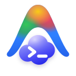
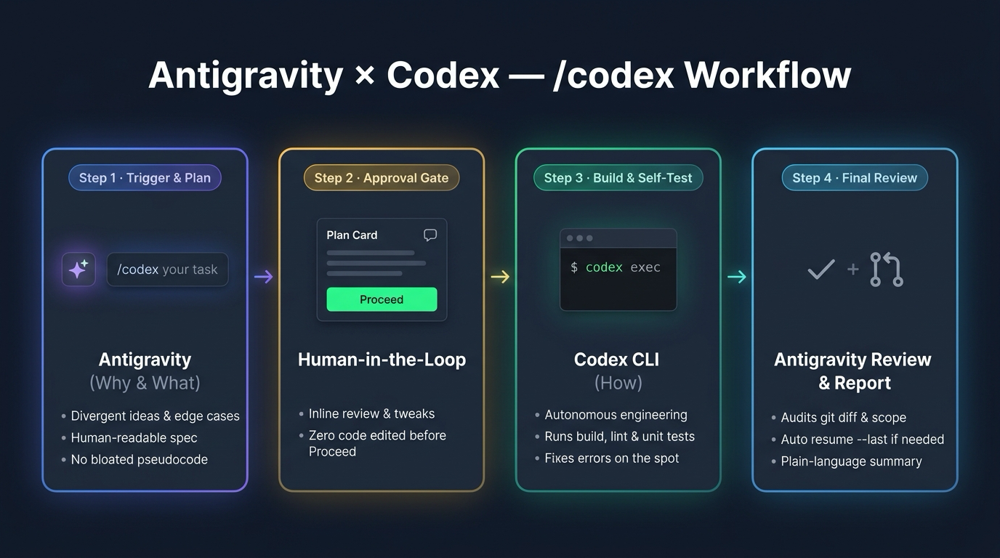
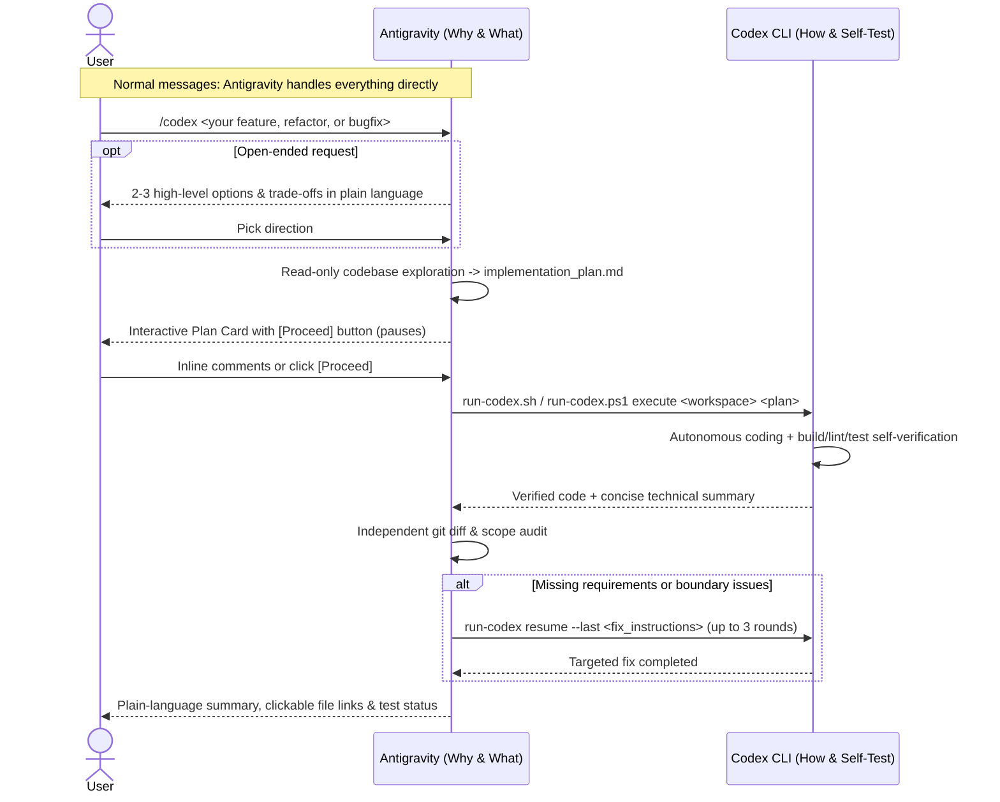

<p align="center">
  
</p>

<h1 align="center">antigravity-codex</h1>

<p align="center">
  <strong>Google Antigravity × OpenAI Codex — On-Demand Dual-Agent Workflow (<code>/codex</code>)</strong>
</p>

<p align="center">
  English | <a href="./README.zh-CN.md">简体中文</a>
</p>

<p align="center">
  <a href="https://github.com/19zbhy/antigravity-codex/actions/workflows/ci.yml">
    
  </a>
</p>

<p align="center">
  
</p>

---

## Why `antigravity-codex`?

A lightweight, zero-dependency native plugin for **Google Antigravity** that pairs **Antigravity** and **Codex CLI** using their complementary strengths — **only when you type `/codex`**:

- **On-Demand `/codex` with 1-Turn Instant Picker**: Everyday chats stay 100% native Antigravity. A tiny (~150-token) `/codex`-scoped `rules/AGENTS.md` preloads your local Codex project & model snapshot so typing `/codex` opens the compact 2-question selector in a **single turn** (in parallel with loading `SKILL.md`), cutting startup latency in half.
- **Native Antigravity Approval UI**: Uses Antigravity's native `implementation_plan.md` artifact (`RequestFeedback: true`) to render an interactive **Proceed** button and inline commenting before a single line of code is touched.
- **Clear Separation of Responsibilities (`Why & What` vs. `How`)**:
  - **Antigravity (Architecture & Final Review)** owns divergent brainstorming, human-readable specs, edge-case guardrails, scope boundaries, and final diff review.
  - **Codex CLI (Engineering & Self-Test)** owns idiomatic implementation and runs build/lint/unit-test loops on the spot before handing back working code.
- **Zero External Bridges & 100% Official Channels**: No MCP servers, no reverse proxies, no tmux wrappers — just a native Antigravity plugin invoking the official `codex exec` / `codex exec resume --last` CLI.
- **Local-Cache-Backed Runtime Picker (`Model` / `Effort` / `Service Tier`)**: Syncs the local `~/.codex/models_cache.json` catalog and top-level `~/.codex/config.toml` defaults into `SKILL.md` on install and after each run, popping up a native Antigravity selector with zero extra pre-flight tool turns (and automatically refreshing as your local Codex CLI cache updates).
- **Whitelist Isolation (`--ignore-user-config`) & Quiet Log-Summary Mode**: By default, `run-codex` skips desktop plugins and MCP servers in `~/.codex/config.toml` (whitelisting only top-level `model`, `model_reasoning_effort`, `service_tier`, and `[features].respect_system_proxy`) to reduce Codex prompt overhead, and writes verbose process logs to a sibling `.log` file while printing only the final summary to stdout (`--no-isolate` / `CODEX_VERBOSE=1` supported).
- **Pinned Session Resume, Thread Forking, & Shared Workspaces**: Uses `--json` event streams (`thread.started`) to pin exact session IDs per run, supports `list-sessions` (read-only `~/.codex/state_5.sqlite` lookup) + `show-session` context handoff + `resume`/`fork`, `init-shared` (`AGENTS.md` + `.agents/state.md` + `SessionStart` hook — see [docs/SHARED_WORKSPACE.md](./docs/SHARED_WORKSPACE.md)), strict `-s read-only` `review`, and fail-closed `--worktree` with safe `cleanup-worktree`.
- **Structured Delivery, Auto Telemetry, & `doctor` Health Check**: Optional `--structured` (`--output-schema resources/report.schema.json`) enforces a 6-field JSON delivery report; every completed run automatically summarizes elapsed duration, token usage (parsed from `*.events.jsonl`), and `git status --short` / `git diff --stat`; `run-codex doctor` verifies CLI, login status, caches, and plugin sync in one command.
- **Cross-Platform & CI-Verified**: Tested in GitHub Actions across **Ubuntu, macOS, and Windows (PowerShell)** with mocked Codex CLI regression suites (`tests/test-run-codex.sh` and `tests/test-run-codex.ps1`).

---

## How It Works



---

## Prerequisites

1. **Google Antigravity** installed.
2. **OpenAI Codex CLI** installed and signed in (either standalone via `npm install -g @openai/codex` / `brew install codex`, or bundled with ChatGPT Desktop on macOS):
   ```bash
   codex --version
   codex login status
   ```
   If not signed in yet, run `codex login` once in your terminal.

---

## Installation (Choose Either Way)

### Option A: One-Command CLI Installer (Recommended)

**macOS / Linux:**
```bash
git clone https://github.com/19zbhy/antigravity-codex.git
cd antigravity-codex
./install.sh
```

**Windows (PowerShell):**
```powershell
git clone https://github.com/19zbhy/antigravity-codex.git
cd antigravity-codex
.\install.ps1
```

The installer automatically:
- Copies the plugin bundle to `~/.gemini/config/plugins/codex-collaborator`
- Replaces `<USER_HOME>` with your literal absolute home path (required for Antigravity's `Always Allow` command prefix matching)
- Configures `run-codex.sh` (macOS/Linux) or `run-codex.ps1` (Windows) and validates syntax & `codex` CLI availability

### Option B: Agent-Native Zero-CLI Install (Drop Into Antigravity)

Don't want to touch the terminal? Drag and drop [docs/INSTALL_WITH_ANTIGRAVITY.md](./docs/INSTALL_WITH_ANTIGRAVITY.md) directly into an Antigravity chat and say:

> *"Please follow this guide to install and verify the `/codex` plugin on my machine."*

Antigravity will detect your home directory, install the plugin files, and verify live registration automatically.

---

## Usage

1. **Regular tasks**: Just chat normally — Gemini responds and edits code directly.
2. **Complex features / refactors / tricky bugs**: Type **`/codex <your request>`** in the Antigravity input box.
3. **Approve the plan**: Review the generated `implementation_plan.md` card, leave inline comments if needed, and click **Proceed**.
4. **First-time permission**: When Antigravity prompts to run `run-codex.sh` (or `run-codex.ps1`), click **Always Allow** so future runs are completely seamless.

---

## Repository Structure

```text
antigravity-codex/
├── README.md                              # English documentation
├── README.zh-CN.md                        # Chinese documentation
├── LICENSE                                # MIT License
├── install.sh                             # macOS / Linux installer
├── install.ps1                            # Windows PowerShell installer
├── assets/
│   ├── logo.svg
│   └── workflow-preview.png               # Workflow visual showcase
├── docs/
│   └── INSTALL_WITH_ANTIGRAVITY.md        # Agent-native drag-and-drop SOP
└── plugin/                                # Plugin template (no hardcoded paths)
    ├── plugin.json
    ├── README.md
    ├── assets/logo.svg
    └── skills/codex/
        ├── SKILL.md                       # /codex workflow skill definition
        └── scripts/
            ├── run-codex.sh               # macOS / Linux runner (Bash 3.2 safe)
            └── run-codex.ps1              # Windows PowerShell runner
```

---

## Acknowledgements & References

`antigravity-codex` stands on the shoulders of the open-source Antigravity & Codex community. Several design ideas were inspired by or adapted from these projects:

- [xinqinnain/antigravity-codex-commander](https://github.com/xinqinnain/antigravity-codex-commander) — quiet log-summary output, concise output discipline, and visual/UI ownership separation.
- [Silhouette-my/codex-in-anti](https://github.com/Silhouette-my/codex-in-anti) — `--ignore-user-config` whitelist isolation and `--worktree` branch isolation.
- [lbc9168/antigravity-codex-worker](https://github.com/lbc9168/antigravity-codex-worker) — scenario-specific task templates (`implementation` / `bugfix` / `review`) and strict `read-only` audit mode.
- [JAY201368/codex-castor](https://github.com/JAY201368/codex-castor) — `doctor` environment health check, structured `--output-schema` delivery report (`report.schema.json`), automatic post-run duration/token telemetry & Git diff summary, and safe `cleanup-worktree` teardown.
- [basicmachines-co/basic-memory](https://github.com/basicmachines-co/basic-memory) — optional cross-agent long-term memory MCP recommended in [docs/SHARED_WORKSPACE.md](./docs/SHARED_WORKSPACE.md).

---

## License

[MIT](./LICENSE)
