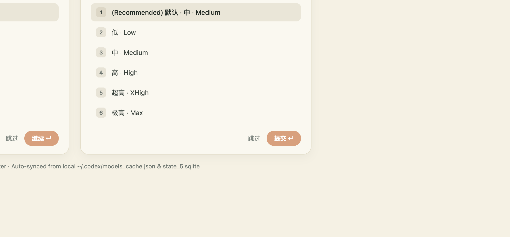
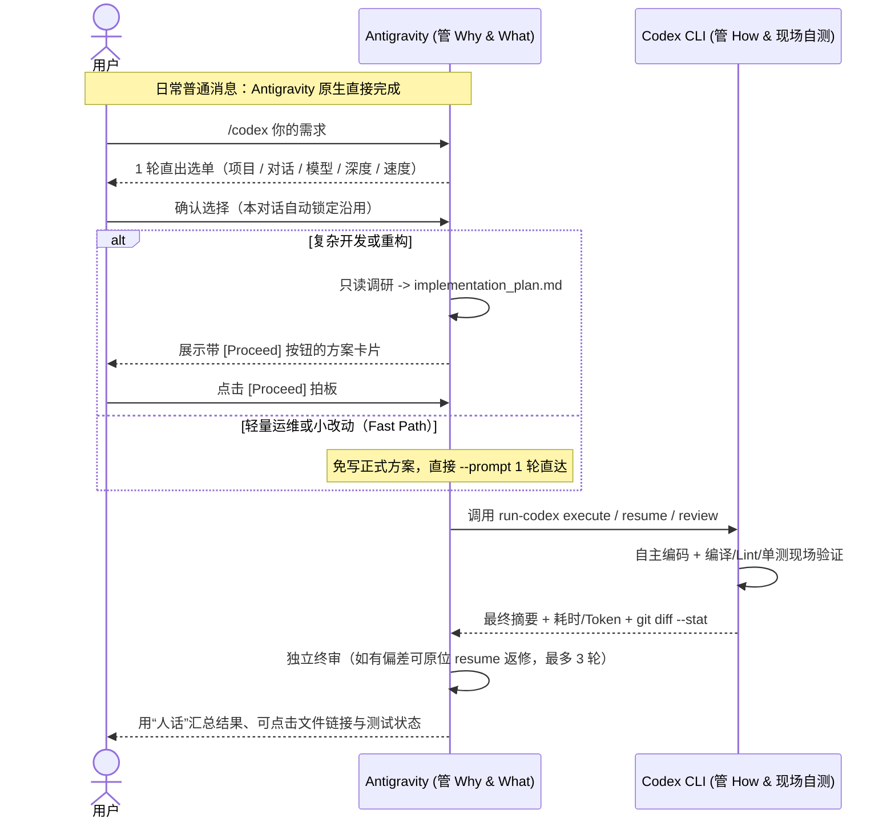

<p align="center">
  
</p>

<h1 align="center">antigravity-codex</h1>

<p align="center">
  <em><code>/codex</code> is all you need.</em>
</p>

<p align="center">
  <strong>Google Antigravity × OpenAI Codex — 按需触发协同工作流</strong>
</p>

<p align="center">
  <a href="./README.md">English</a> | 简体中文 | <a href="https://19zbhy.github.io/antigravity-codex/">项目官网首页</a>
</p>

<p align="center">
  <a href="https://github.com/19zbhy/antigravity-codex/actions/workflows/ci.yml">
    
  </a>
  <a href="./LICENSE">
    
  </a>
  
</p>

<p align="center">
  
</p>

> [!NOTE]
> 本项目为独立开源社区作品，与 Google、Antigravity 或 OpenAI 无官方关联或背书。安全边界与版本记录见 [SECURITY.md](./SECURITY.md) 和 [CHANGELOG.md](./CHANGELOG.md)。

---

## 1. 为什么要在 Antigravity 里操作 Codex？

**Google Antigravity** 和 **OpenAI Codex** 各有明显长板，组合在一起才是完整闭环：

| 维度 | Google Antigravity | OpenAI Codex CLI | 通过 `/codex` 双脑合体 |
| --- | --- | --- | --- |
| **核心长板** | 发散探路、人话对齐需求、原生交互卡片（`ask_question` / `implementation_plan.md` + **Proceed** 门禁）、多模态审图 | 扎实的多文件工程实现、现场编译/Lint/单测自验证闭环 | **Antigravity 管 `Why & What` 与终审；Codex 管 `How` 与现场自测** |
| **日常痛点** | 两个客户端之间来回切窗口、复制粘贴上下文非常割裂 | 缺少 Antigravity 原生方案卡片与交互式审批体验 | **留在 Antigravity 一个窗口里**，需要时敲 `/codex` 即可召唤 |
| **桥接成本** | 重型 MCP Bridge 需要常驻后台进程，且常放开沙箱权限 | 独立 CLI 不会自动共享跨端项目状态 | **零 MCP 常驻服务、零逆向反代、默认安全沙箱** |

---

## 2. 核心功能

### 按需触发 · 1 轮秒弹点选卡片
- **平时零侵入**：日常问答和小修小补依然 100% 由 Antigravity 原生完成。
- **1 轮直出本地化选单**：通过极轻量仅对 `/codex` 生效的 `rules/AGENTS.md` 预载本机缓存，敲 `/codex` 第 1 轮直接弹出无冗余括号的 4 题选单（**Codex 项目 / 模型 / 中英对照思考深度 / 极速与标准速度**）。
- **同一对话自动锁定**：首次选完后本对话自动锁定沿用，**后续消息免敲 `/codex`**；发 **`退出 /codex`** 随时切回纯 Antigravity。

<p align="center">
  
</p>

### 与 Codex 桌面端无缝接力（核心差异化）
- **原生读取 Codex 项目与侧边栏真实对话名**：只读查询 `~/.codex/state_5.sqlite`（内置 WAL 锁 `immutable=1` 降级保护），自动把每个项目最近 6 条活跃对话预同步进 `SKILL.md`，选完项目后第 2 张「选择对话」卡片 1 轮直出。
- **真正承接老对话上下文（`show-session` + `resume`）**：自动提取选中老对话的纯净历史给 Antigravity 了解背景，执行时默认原位 `resume --session <id>` 续写回 Codex 原对话。
- **桌面端写锁安全征询**：遇到 Codex 桌面端占用线程锁（`already has an active writer`）时绝不擅自关软件，先弹窗征求你同意（同意则 `--quit-app-on-lock` 优雅关闭并原位续聊；不同意则无损 `fork`）。
- **双端项目共享（`init-shared`）**：一键生成 `AGENTS.md`、`.agents/state.md` 与 `SessionStart` Hook，让独立 Codex 与 Antigravity 双向感知最近改动（详见 [docs/SHARED_WORKSPACE.md](./docs/SHARED_WORKSPACE.md)）。

### 分级执行 · 安全沙箱 · 红队对抗式审查
- **复杂门禁 + 轻量快车道**：跨文件开发与重构走 `implementation_plan.md` + **Proceed** 审批门禁；启停服务、跑测试、查日志等轻量操作自动走 **Fast Path**，通过 `--prompt` 1 轮直达、免写临时任务文件。
- **严守沙箱边界**：写代码使用 `--approve-for-me`（`workspace-write`），绝不启用 `--dangerously-bypass-approvals-and-sandbox`；代码审查强制 `-s read-only`，内置 **`--adversarial` 红队对抗式审查**与 **`--base <branch>` 分支 Diff 审查**。
- **隔离分支闭环**：`--worktree` 严格 fail-closed（不支持绝不降级写主目录），配套安全清理命令 `cleanup-worktree`。

### 轻量隔离 · 自动遥测 · 三平台 CI 验证
- **白名单隔离（`--ignore-user-config`）**：跳过桌面端重型插件与 MCP，仅透传顶层模型/推理强度/速度档位与代理开关（检测到自定义 `model_provider` 时自动回退完整配置）。
- **静默摘要 + 耗时/Token/Diff 自动汇总**：过程事件流（`*.events.jsonl`）与日志（`*.log`）落盘，终端仅输出最终摘要、**本轮耗时、Token 消耗及 `git status --short` / `git diff --stat`**（支持 `--structured` 6 字段 JSON 报告）。
- **一键体检与跨平台测试**：内置 `run-codex doctor` 一键核验 CLI、登录态、缓存与插件同步；三平台 GitHub Actions（**Ubuntu / macOS / Windows**）持续回归验证。

---

## 3. 一键安装与启动

### 环境要求
1. 已安装 **Google Antigravity**。
2. 已安装并登录 **OpenAI Codex CLI**（支持 `npm install -g @openai/codex`、`brew install codex`，也自动兼容 macOS ChatGPT 桌面端自带 `codex`）：
   ```bash
   codex --version
   codex login status
   ```
   若尚未登录，在终端运行一次 `codex login` 即可。

### 方式一：命令行一键安装（推荐）

**macOS / Linux：**
```bash
git clone https://github.com/19zbhy/antigravity-codex.git
cd antigravity-codex
./install.sh --dry-run   # 可选：先预演将修改的文件路径
./install.sh
# 随时一键干净卸载：./install.sh --uninstall
```

**Windows (PowerShell)：**
```powershell
git clone https://github.com/19zbhy/antigravity-codex.git
cd antigravity-codex
.\install.ps1 -DryRun    # 可选：先预演将修改的文件路径
.\install.ps1
# 随时一键干净卸载：.\install.ps1 -Uninstall
```

安装完成后可跑一句一键体检确认环境全绿：
```bash
~/.gemini/config/plugins/codex-collaborator/skills/codex/scripts/run-codex.sh doctor
```

### 方式二：拖进 Antigravity 自动安装（零终端）

直接把 [docs/INSTALL_WITH_ANTIGRAVITY.md](./docs/INSTALL_WITH_ANTIGRAVITY.md) 拖进 Antigravity 对话框，发送：

> **「请严格按照这份文档，帮我在本机自动部署并验证这套 `/codex` 协同插件」**

---

## 4. 具体使用方法



### 高频场景速查

| 你想做什么 | 在 Antigravity 里怎么说 |
| --- | --- |
| **开发新功能 / 跨文件重构** | `/codex 帮我重构鉴权模块并补齐单测` → 选项目与档位 → 审阅方案点 **Proceed** |
| **接力 Codex 桌面端老对话** | `/codex` → 选 Codex 项目 → 点选已有对话名 → 自动承接历史上下文并原位续聊 |
| **轻量操作快车道** | 已锁定 `/codex` 的对话里直接发「跑一下测试 / 重启本地服务」（免敲 `/codex`、免审批直达） |
| **红队对抗式代码审查** | `/codex 对抗式审查当前分支相对 main 的改动`（强制 `read-only` + `--adversarial --base main`） |
| **中途切换项目 / 模型** | 在同一对话里**再次输入 `/codex`** 重新弹出选择卡片 |
| **当前对话退出 `/codex`** | 直接发 **`退出 /codex`**（或「关闭协同，后面由你直接改」）切回纯 Antigravity |

> **首次放行提示**：第一次触发 `run-codex.sh`（或 `run-codex.ps1`）弹出命令确认框时，勾选 **Always Allow（始终允许）**，后续即可全程无感自动跑完。

---

## 5. 常见问题（FAQ）

<details>
<summary><strong>Q1：平时不用 <code>/codex</code> 的普通对话会变慢或被塞入很多上下文吗？</strong></summary>

不会。普通对话依然 100% 由 Antigravity 原生处理。插件只在 `rules/AGENTS.md` 里预载了约 150 tokens 的极简选单快照，用于让 `/codex` 第 1 轮直出卡片；完整的 `SKILL.md` 与各项目最近对话列表只在你输入 `/codex` 时才按需加载。
</details>

<details>
<summary><strong>Q2：同一个对话里需要每句都敲 <code>/codex</code> 吗？中途想关掉怎么办？</strong></summary>

不需要。同一对话首次 `/codex` 选定项目、会话与档位后会自动锁定沿用，后续直接发普通消息即可。想换配置时再敲一次 `/codex`；想在本对话里切回纯 Antigravity（比如承接完 Codex 老对话历史后只让 Gemini 自己改），发一句 **`退出 /codex`** 即可。如需全局停用，在 Antigravity **自定义（Customizations）** 中关闭 `codex-collaborator` 即可。
</details>

<details>
<summary><strong>Q3：续聊 Codex 老对话时，为什么偶尔会提示“正在被 Codex 桌面端占用”？</strong></summary>

Codex 桌面端运行期间会对最近打开过的线程持有独占写锁（`already has an active writer`）。为了避免擅自关掉你正在用的桌面端，插件会先弹窗让你二选一：**同意优雅关闭 Codex 桌面端并原位续聊**（`--quit-app-on-lock`），或**不关闭桌面端、无损分叉（`fork`）继承全部历史继续**。
</details>

<details>
<summary><strong>Q4：在 Antigravity 里续聊后，Codex 桌面端能看到更新吗？</strong></summary>

能。原位 `resume` 会把新回合直接写回 Codex 原对话，且两边操作的是磁盘上同一份项目源码；配合 `init-shared` 生成的 `.agents/state.md`，切换回独立 Codex 时也能立刻感知最新进展。
</details>

<details>
<summary><strong>Q5：为什么不做成一个常驻 MCP Server？</strong></summary>

保持纯原生插件 + Shell/PowerShell 执行器，意味着**零后台常驻进程**、Windows 用户无需额外配置 Python/Node 运行环境、脚本行为透明可审计，并且 100% 走官方 `codex exec` 正门通道。
</details>

---

## 6. 进阶命令与仓库结构

<details>
<summary><strong>展开查看 <code>run-codex</code> 子命令与完整目录树</strong></summary>

### `run-codex.sh` / `run-codex.ps1` 全部子命令
- `doctor` — 一键体检（CLI、登录态、支持参数、缓存、`state_5.sqlite`、`git` 与 `SKILL.md` 同步状态）
- `list-options` / `sync-options` — 查看或刷新本机模型、推理强度、Codex 项目与最近对话快照
- `list-projects` / `list-sessions` / `show-session` — 只读查询 Codex 桌面端项目列表与历史对话内容
- `init-shared <ws> [--exclude-state]` — 初始化 `AGENTS.md`、`.agents/state.md` 与 `SessionStart` Hook
- `execute` / `resume` / `fork` — 在 `workspace-write` 沙箱执行任务（支持 `--prompt`、`--worktree`、`--structured`、`--quit-app-on-lock`、`--no-isolate`、`--verbose`）
- `review` — 严格 `read-only` 代码审查（支持 `--adversarial`、`--base <branch>`、`--structured`）
- `cleanup-worktree <path> [--delete-branch] [--force]` — 安全清理临时 worktree 与已合并分支

### 仓库目录结构
```text
antigravity-codex/
├── README.md                                  # 英文主文档
├── README.zh-CN.md                            # 中文主文档
├── SECURITY.md                                # 沙箱与安全策略说明
├── CHANGELOG.md                               # 版本更新日志
├── LICENSE                                    # MIT 开源协议
├── install.sh                                 # macOS / Linux 安装器（支持 --dry-run / --uninstall）
├── install.ps1                                # Windows PowerShell 安装器（支持 -DryRun / -Uninstall）
├── assets/
│   ├── logo.svg                               # 插件图标
│   ├── workflow-preview.png                   # 工作流视觉横幅
│   └── codex-picker-preview.png               # /codex 1 轮选单效果预览图
├── docs/
│   ├── INSTALL_WITH_ANTIGRAVITY.md            # 拖入 Antigravity 自动部署指南
│   └── SHARED_WORKSPACE.md                    # 双端共享工作区详细说明
├── plugin/                                    # 干净的插件模板（无任何个人路径）
│   ├── plugin.json
│   ├── README.md
│   ├── assets/logo.svg
│   ├── rules/AGENTS.md                        # 极轻量 /codex 1 轮选单预热规则
│   └── skills/codex/
│       ├── SKILL.md                           # /codex 协同技能定义
│       ├── resources/
│       │   ├── implementation-task.md
│       │   ├── bugfix-task.md
│       │   ├── review-task.md
│       │   ├── adversarial-review-task.md
│       │   └── report.schema.json
│       └── scripts/
│           ├── run-codex.sh                   # macOS / Linux 执行器（兼容 Bash 3.2）
│           └── run-codex.ps1                  # Windows PowerShell 执行器
└── tests/
    ├── test-run-codex.sh                      # 111 项 Bash 回归测试套件
    └── test-run-codex.ps1                     # Windows PowerShell 回归测试套件
```
</details>

---

## 致谢与参考项目

`antigravity-codex` 在开发过程中受益于多个优秀的开源社区项目，以下设计思路借鉴或参考自这些仓库：

- [xinqinnain/antigravity-codex-commander](https://github.com/xinqinnain/antigravity-codex-commander) — 静默日志摘要输出、精简输出纪律与前端视觉分工思路。
- [Silhouette-my/codex-in-anti](https://github.com/Silhouette-my/codex-in-anti) — `--ignore-user-config` 白名单隔离与 `--worktree` 分支隔离思路。
- [lbc9168/antigravity-codex-worker](https://github.com/lbc9168/antigravity-codex-worker) — 分场景任务模板（`implementation` / `bugfix` / `review`）与严格 `read-only` 只读审查模式。
- [JAY201368/codex-castor](https://github.com/JAY201368/codex-castor) — `doctor` 环境一键体检、结构化 `--output-schema` 交付报告（`report.schema.json`）、执行后自动耗时/Token 遥测与 Git Diff 摘要，以及 `cleanup-worktree` 安全清理设计。
- [vacuityv/codex-plugin-antigravity](https://github.com/vacuityv/codex-plugin-antigravity) — 红队对抗式审查（`--adversarial`）与 `--base <branch>` 分支 Diff 审查思路。
- [crazyzhang277/codex-antigravity-bridge](https://github.com/crazyzhang277/codex-antigravity-bridge) — 安装脚本预演模式（`--dry-run` / `-DryRun`）与一键干净卸载思路。
- [IlleJiViN/codex-antigravity-subagent](https://github.com/IlleJiViN/codex-antigravity-subagent) — 独立社区项目合规声明与 `SECURITY.md` / `CHANGELOG.md` 规范。
- [basicmachines-co/basic-memory](https://github.com/basicmachines-co/basic-memory) — [docs/SHARED_WORKSPACE.md](./docs/SHARED_WORKSPACE.md) 中推荐的可选跨端长期记忆 MCP 方案。

## 开源协议

[MIT](./LICENSE)
