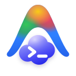
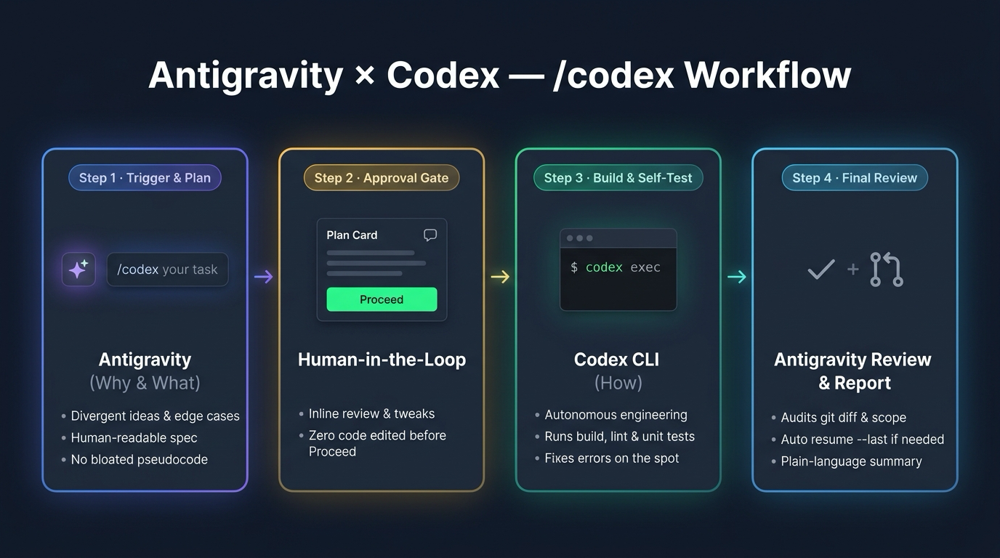
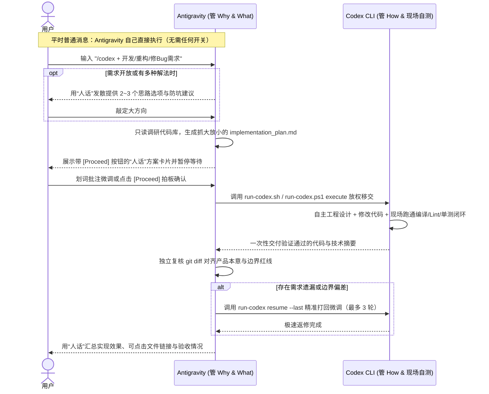

<p align="center">
  
</p>

<h1 align="center">antigravity-codex</h1>

<p align="center">
  <strong>Google Antigravity × OpenAI Codex — 按需触发协同工作流（<code>/codex</code>）</strong>
</p>

<p align="center">
  <a href="./README.md">English</a> | 简体中文
</p>

<p align="center">
  <a href="https://github.com/19zbhy/antigravity-codex/actions/workflows/ci.yml">
    
  </a>
</p>

<p align="center">
  
</p>

---

## 为什么选择 `antigravity-codex`？

一套为 **Google Antigravity** 打造的轻量、零依赖原生插件，将 **Antigravity** 与 **Codex CLI** 的各自长板结合起来——并且**只在你输入 `/codex` 时按需触发**：

- **按需触发 + 1 轮秒弹本地化点选卡片**：日常问答和小改动依然由 Antigravity 原生完成；内置极轻量仅对 `/codex` 生效的 `rules/AGENTS.md` 预热快照，输入 `/codex` 时在第 1 轮并行加载 `SKILL.md` 并弹出全中文（或跟随用户语言）的 4 题选择器（Codex 项目 / 模型 / 思考深度 / 响应速度），将启动延迟直接砍半。
- **深度原生 UI 门禁**：调用 Antigravity 原生 `implementation_plan.md` 方案卡片（`RequestFeedback: true`），渲染可点击的 **Proceed** 按钮并支持划词批注微调，未拍板前严禁修改一行代码。
- **清晰的职责分工（`Why & What` vs. `How`）**：
  - **Antigravity（需求分析 + 终审把关）**：负责发散思维探路、输出抓大放小的“人话”任务书、划定边缘防坑清单与红线边界、独立复核 `git diff` 并用人话汇报。
  - **Codex CLI（工程实现 + 现场自测）**：拿到清晰目标后自主决定最地道的工程实现，并在工作区现场跑通构建、Lint 与单测闭环，一次交出能跑通的代码。
- **零第三方桥接 · 100% 官方正门**：不装 MCP Server、不用逆向反代、不依赖 tmux，直接通过官方 `codex exec` / `codex exec resume --last` 命令行协作，合规稳定。
- **基于本机缓存的秒弹点选卡片（模型 / 推理强度 / 服务档位）**：安装与每次执行后自动解析本机 `~/.codex/models_cache.json` 与 `~/.codex/config.toml` 顶层默认项并同步进 `SKILL.md`，触发 `/codex` 时零额外命令轮次直接弹出当前本机缓存中的模型与推理强度列表（随本地 Codex 缓存更新自动刷新）。
- **白名单轻量隔离（`--ignore-user-config`）+ 静默日志摘要**：默认跳过桌面 `~/.codex/config.toml` 里的插件与 MCP（仅白名单透传顶层 `model`、`model_reasoning_effort`、`service_tier` 与 `[features].respect_system_proxy`）以降低 Codex 启动上下文开销；同时将过程日志落盘 `.log`、终端仅回传最终摘要（支持 `--no-isolate` / `CODEX_VERBOSE=1`）。
- **精确会话绑定、老线程承接与双端项目共享**：通过 `--json` 结构化事件流精确绑定任务 `session_id`；内置 `list-projects` / `list-sessions`（只读检索 `~/.codex/state_5.sqlite`）、`show-session` 历史对话摘要提取、`resume`/`fork`、一键 `init-shared`（生成 `AGENTS.md` + `.agents/state.md` + `SessionStart` Hook，详见 [docs/SHARED_WORKSPACE.md](./docs/SHARED_WORKSPACE.md)），以及严格 `read-only` 审查、失败即中止的 `--worktree` 与安全清理命令 `cleanup-worktree`。
- **结构化交付、自动遥测汇总与 `doctor` 一键体检**：支持 `--structured`（内置 `resources/report.schema.json`）约束 Codex 输出 6 字段结构化报告；每次执行结束后自动汇总耗时、Token 消耗（解析自 `*.events.jsonl`）及 `git status --short` / `git diff --stat`；内置 `run-codex doctor` 一键检查 CLI、登录态、本地缓存与插件同步状态。
- **跨平台回归测试与 CI**：内置 Mock Codex CLI 回归测试套件（`tests/test-run-codex.sh` 与 `tests/test-run-codex.ps1`），在 GitHub Actions 上持续验证 **Ubuntu / macOS / Windows** 三平台行为。

---

## 工作流时序图



---

## 环境要求

1. 已安装 **Google Antigravity**。
2. 已安装并登录 **OpenAI Codex CLI**（支持 `npm install -g @openai/codex`、`brew install codex`，也自动兼容 macOS ChatGPT 桌面端自带的 `codex`）：
   ```bash
   codex --version
   codex login status
   ```
   若尚未登录，在终端执行一次 `codex login` 完成授权即可。

---

## 安装方式（任选其一）

### 方式一：命令行一键安装（推荐）

**macOS / Linux：**
```bash
git clone https://github.com/19zbhy/antigravity-codex.git
cd antigravity-codex
./install.sh
```

**Windows (PowerShell)：**
```powershell
git clone https://github.com/19zbhy/antigravity-codex.git
cd antigravity-codex
.\install.ps1
```

安装脚本会自动完成：
- 将插件复制到 `~/.gemini/config/plugins/codex-collaborator`
- 自动将模板中的 `<USER_HOME>` 替换为你的真实绝对路径（确保 Antigravity `Always Allow` 命令前缀放行生效）
- 赋予脚本可执行权限、检查语法并核验本机 `codex` CLI 登录状态

### 方式二：把安装文档直接拖给 Antigravity 自动安装（Agent-Native）

不想敲终端命令？直接将 [docs/INSTALL_WITH_ANTIGRAVITY.md](./docs/INSTALL_WITH_ANTIGRAVITY.md) 拖进 Antigravity 对话框，发送一句：

> **「请严格按照这份文档，帮我在本机自动部署并验证这套 `/codex` 双脑协同插件」**

Gemini 就会自动帮你检测环境、替换本机路径、写入全局插件并验证热加载生效。

---

## 使用指南

1. **日常问答 / 小修小补**：直接发消息，由 Antigravity 独立完成。
2. **开启双脑协同**：在输入框敲 **`/codex 你的需求`**，一键选定 Codex 项目（或当前工作区）、新建/续接老对话、模型、思考深度与响应速度。
3. **同一对话免重复输入**：首次选定后，本对话会自动锁定并沿用该配置——**后续消息无需再敲 `/codex`**，直接继续聊需求即可。
4. **中途切换项目 / 会话 / 档位**：在同一对话内**再次输入 `/codex`**，即可重新弹出选择卡片切换配置。
5. **在当前对话退出 `/codex`**：直接发送 **`退出 /codex`**（或「关闭协同，后面由你直接改」），即可在当前对话中解除锁定、切回纯 Antigravity 模式。（如需全局停用整个插件，可在 Antigravity 左侧栏 **自定义（Customizations）** 中关闭 `codex-collaborator`。）
6. **审阅拍板与首次放行**：复杂改动会弹出 `implementation_plan.md` 方案卡片，满意后点击 **Proceed**（轻量运维/小改动自动走快车道直达）。首次运行 `run-codex.sh`（或 `run-codex.ps1`）弹出命令确认框时，勾选 **Always Allow（始终允许）**，后续即可全程无感自动跑完。

---

## 仓库目录结构

```text
antigravity-codex/
├── README.md                              # 英文主文档
├── README.zh-CN.md                        # 中文文档
├── LICENSE                                # MIT 开源协议
├── install.sh                             # macOS / Linux 一键安装脚本
├── install.ps1                            # Windows PowerShell 一键安装脚本
├── assets/
│   ├── logo.svg                           # 插件图标
│   └── workflow-preview.png               # 四步闭环视觉演示图
├── docs/
│   └── INSTALL_WITH_ANTIGRAVITY.md        # 拖入 Antigravity 自动部署 SOP
└── plugin/                                # 干净的插件模板（无硬编码个人路径）
    ├── plugin.json
    ├── README.md
    ├── assets/logo.svg
    └── skills/codex/
        ├── SKILL.md                       # /codex 协同技能定义
        └── scripts/
            ├── run-codex.sh               # macOS / Linux 执行器（兼容 Bash 3.2）
            └── run-codex.ps1              # Windows PowerShell 执行器
```

---

## 致谢与参考项目

`antigravity-codex` 在开发过程中受益于多个优秀的开源社区项目，以下设计思路借鉴或参考自这些仓库：

- [xinqinnain/antigravity-codex-commander](https://github.com/xinqinnain/antigravity-codex-commander) — 静默日志摘要输出、精简输出纪律与前端视觉分工思路。
- [Silhouette-my/codex-in-anti](https://github.com/Silhouette-my/codex-in-anti) — `--ignore-user-config` 白名单隔离与 `--worktree` 分支隔离思路。
- [lbc9168/antigravity-codex-worker](https://github.com/lbc9168/antigravity-codex-worker) — 分场景任务模板（`implementation` / `bugfix` / `review`）与严格 `read-only` 只读审查模式。
- [JAY201368/codex-castor](https://github.com/JAY201368/codex-castor) — `doctor` 环境一键体检、结构化 `--output-schema` 交付报告（`report.schema.json`）、执行后自动耗时/Token 遥测与 Git Diff 摘要，以及 `cleanup-worktree` 安全清理设计。
- [basicmachines-co/basic-memory](https://github.com/basicmachines-co/basic-memory) — [docs/SHARED_WORKSPACE.md](./docs/SHARED_WORKSPACE.md) 中推荐的可选跨端长期记忆 MCP 方案。

---

## 开源协议

[MIT](./LICENSE)
