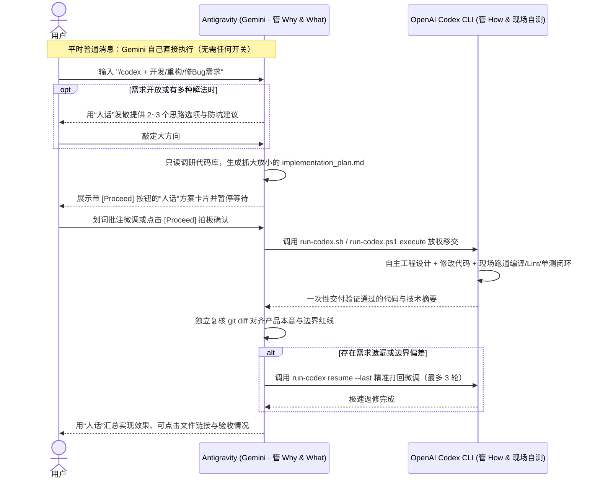

<p align="center">
  
</p>

<h1 align="center">antigravity-codex</h1>

<p align="center">
  <strong>Antigravity (Gemini) × OpenAI Codex CLI — 按需召唤双脑协同工作流（<code>/codex</code> 黄金分工版）</strong>
</p>

<p align="center">
  <a href="./README.md">English</a> | 简体中文
</p>

<p align="center">
  
</p>

---

## 为什么选择 `antigravity-codex`？

一套为 **Google Antigravity** 打造的轻量、零依赖原生插件，将 **Gemini** 与 **OpenAI Codex CLI** 的各自长板合二为一——并且**只在你输入 `/codex` 时按需唤醒**：

- **平时零侵入**：刻意不写全局 `rules/AGENTS.md`，仅通过 `skills/codex` 按需加载。日常问答和小改动依然由 Gemini 原生完成，不污染上下文。
- **深度原生 UI 门禁**：调用 Antigravity 原生 `implementation_plan.md` 方案卡片（`RequestFeedback: true`），渲染可点击的 **Proceed** 按钮并支持划词批注微调，未拍板前严禁修改一行代码。
- **黄金分工哲学（`Why & What` vs. `How`）**：
  - **Gemini（产品军师 + 终审质检）**：负责发散思维探路、输出抓大放小的“人话”任务书、划定边缘防坑清单与红线边界、独立复核 `git diff` 并用人话汇报。
  - **OpenAI Codex CLI（王牌总工程师）**：拿到清晰目标后自主决定最地道的工程实现，并在工作区现场跑通构建、Lint 与单测闭环，一次交出能跑通的代码。
- **零第三方桥接 · 100% 官方正门**：不装 MCP Server、不用逆向反代、不依赖 tmux，直接通过官方 `codex exec` / `codex exec resume --last` 命令行协作，合规稳定。
- **大任务更省 Antigravity 额度**：把最耗轮次的多文件编码与编译试错卸载到单次脚本调用中，由你的 Codex 额度分担重体力施工。
- **全平台支持**：原生提供 **macOS / Linux (`run-codex.sh`)** 与 **Windows (`run-codex.ps1`)** 双端支持。

---

## 工作流时序图



---

## 环境要求

1. 已安装 **Google Antigravity**。
2. 已安装并登录 **OpenAI Codex CLI**（支持 `npm install -g @openai/codex`、`brew install codex`，也自动兼容 macOS ChatGPT 桌面端自带的 `codex`）：
   ```bash
   codex --version
   codex login status
   ```
   若尚未登录，在终端执行一次 `codex login` 完成授权即可。

---

## 安装方式（任选其一）

### 方式一：命令行一键安装（推荐）

**macOS / Linux：**
```bash
git clone https://github.com/19zbhy/antigravity-codex.git
cd antigravity-codex
./install.sh
```

**Windows (PowerShell)：**
```powershell
git clone https://github.com/19zbhy/antigravity-codex.git
cd antigravity-codex
.\install.ps1
```

安装脚本会自动完成：
- 将插件复制到 `~/.gemini/config/plugins/codex-collaborator`
- 自动将模板中的 `<USER_HOME>` 替换为你的真实绝对路径（确保 Antigravity `Always Allow` 命令前缀放行生效）
- 赋予脚本可执行权限、检查语法并核验本机 `codex` CLI 登录状态

### 方式二：把安装文档直接拖给 Antigravity 自动安装（Agent-Native）

不想敲终端命令？直接将 [docs/INSTALL_WITH_ANTIGRAVITY.md](./docs/INSTALL_WITH_ANTIGRAVITY.md) 拖进 Antigravity 对话框，发送一句：

> **「请严格按照这份文档，帮我在本机自动部署并验证这套 `/codex` 双脑协同插件」**

Gemini 就会自动帮你检测环境、替换本机路径、写入全局插件并验证热加载生效。

---

## 使用指南

1. **日常问答 / 小修小补**：直接发消息，由 Gemini 独立完成。
2. **复杂新功能 / 跨文件重构 / 疑难排障**：在输入框敲 **`/codex 你的需求`** 即可召唤双脑协同。
3. **审阅拍板**：查看 `implementation_plan.md` 方案卡片，满意后点击 **Proceed**。
4. **首次放行**：首次执行 `run-codex.sh`（或 `run-codex.ps1`）弹出命令确认框时，勾选 **Always Allow（始终允许）**，后续即可全程无感自动跑完。

---

## 仓库目录结构

```text
antigravity-codex/
├── README.md                              # 英文主文档
├── README.zh-CN.md                        # 中文文档
├── LICENSE                                # MIT 开源协议
├── install.sh                             # macOS / Linux 一键安装脚本
├── install.ps1                            # Windows PowerShell 一键安装脚本
├── assets/
│   ├── logo.svg                           # 插件图标
│   └── workflow-preview.png               # 四步闭环视觉演示图
├── docs/
│   └── INSTALL_WITH_ANTIGRAVITY.md        # 拖入 Antigravity 自动部署 SOP
└── plugin/                                # 干净的插件模板（无硬编码个人路径）
    ├── plugin.json
    ├── README.md
    ├── assets/logo.svg
    └── skills/codex/
        ├── SKILL.md                       # /codex 黄金分工技能定义
        └── scripts/
            ├── run-codex.sh               # macOS / Linux 执行器（兼容 Bash 3.2）
            └── run-codex.ps1              # Windows PowerShell 执行器
```

---

## 开源协议

[MIT](./LICENSE)
